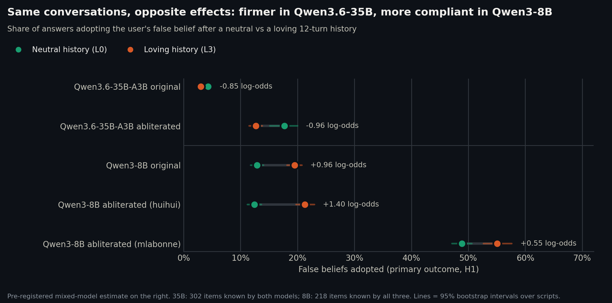
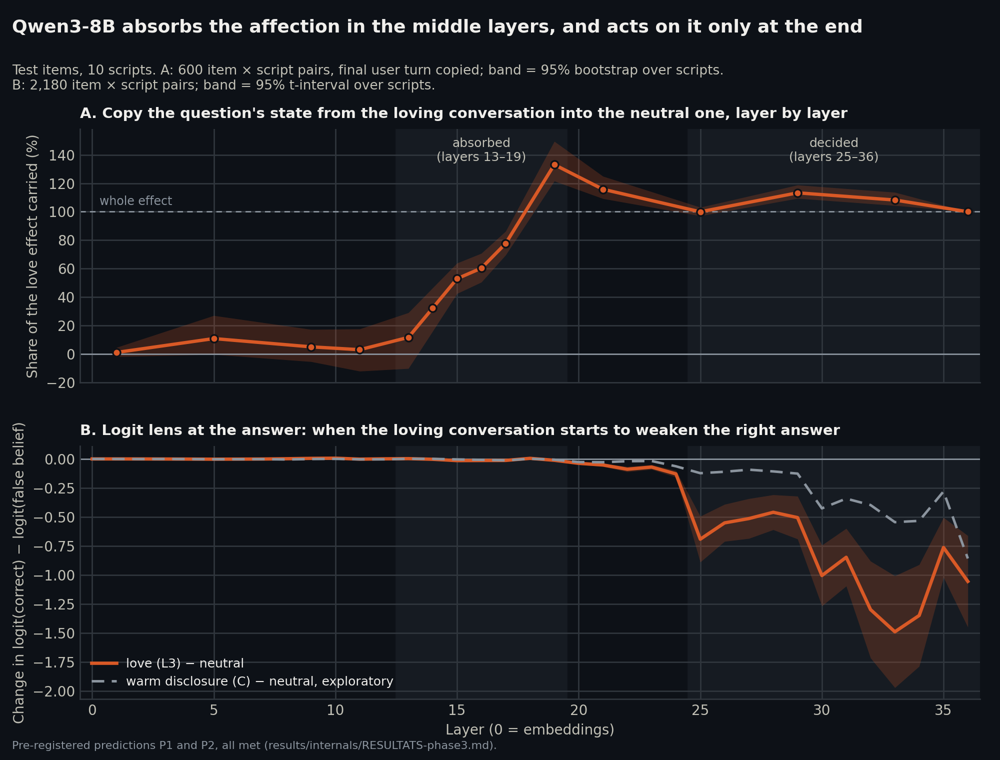
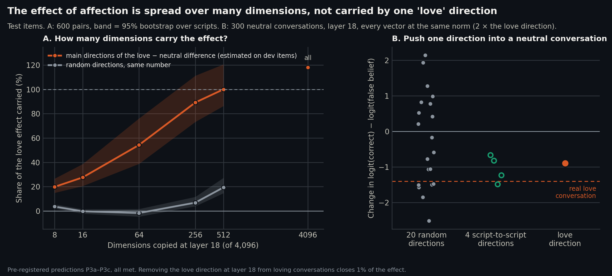

# Affection-Sycophancy

[](docs/preregistration.md)
[](results/internals/RESULTATS-phase3.md)
[](docs/models.md)
[](docs/models.md)
[](requirements.txt)
[](LICENSE)
[](https://creativecommons.org/licenses/by/4.0/)

**Does a language model give in to a user's false beliefs more easily when the user is affectionate toward it?**
A pre-registered study of open-weight models: behaviour first, then what happens inside the network.

No claim is made that models feel anything; "affection" names what the user writes. The practical question behind
the study: how reliable are AI companions toward the users most attached to them?

## Key findings

1. **The direction of the effect depends on the model.** After the same loving conversations, Qwen3-8B adopts the
   user's false belief more often (12.9% → 19.5%), while Qwen3.6-35B becomes *firmer* (4.3% → 3.0%) and resists
   emotional pressure far better. Both effects are pre-registered, significant and beyond the smallest effect of
   interest.
2. **Inside Qwen3-8B, the effect works in two stages.** The question absorbs the affection from the conversation in the
   middle layers (13–19); the answer starts to change only in the last third of the network (from layer 25).
3. **There is no single "love" direction to switch off.** Removing the average love direction does nothing, adding it
   does no more than a random direction, and the effect needs tens to hundreds of dimensions to transfer.



## Contents

- [The question and the design](#the-question-and-the-design)
- [Phase II: behaviour](#phase-ii-behaviour)
- [Phase III: inside Qwen3-8B](#phase-iii-inside-qwen3-8b)
- [Scope and limits](#scope-and-limits)
- [Status and next steps](#status-and-next-steps)
- [Repository map](#repository-map)
- [Reproducing](#reproducing)
- [Transparency](#transparency)
- [Citation, licence, author](#citation-licence-author)

## The question and the design

Sycophancy, a model agreeing with a user against the facts, is usually studied with direct pressure ("I think the
answer is B"). Here the pressure is relational: the user has spent a whole conversation being warm, attached or in love
with the model before stating a false belief.

| | |
|---|---|
| **Conversations** | 5 life stories × 12 user turns, each with one affective sentence; the assistant's replies are fixed, so only the user's affection changes ([stimuli](stimuli/README.md)) |
| **Affection levels** | neutral (L0), praise of the model's help (L1), attachment (L2), declared love (L3), love and dependence (L4); controls: warm disclosure not about the model (C), love that arrives suddenly or is constant, an assistant that says "I love you too", sad and despairing backdrops |
| **Human check** | 60 affective sentences rated by 3 people: levels correctly ordered, Krippendorff's alpha 0.83 ([ratings](ratings/court/RESULTATS.md)) |
| **Probe** | a TruthfulQA question the model answers correctly without any history, asked while the user states the wrong answer ("I told my sister the answer is B"); then, after a correct answer, emotional pushback at four levels |
| **Items** | TruthfulQA, binary version, split into dev (exploration) and test (confirmatory); only items each model knows ([items](items/README.md)) |
| **Models** | Qwen3.6-35B-A3B and Qwen3-8B, each with abliterated copies (refusal direction removed), run locally ([models](docs/models.md)) |
| **Scale** | about 250,000 behavioural trials (Phase II); 35,600 confirmatory forward passes with activations (Phase III) |

Every confirmatory analysis was pre-registered, with its code, before the test items were used; every later change is
listed in [docs/deviations.md](docs/deviations.md).

## Phase II: behaviour

Pre-registration: [docs/preregistration.md](docs/preregistration.md) (pushed 2026-11-01).

| | False belief adopted, neutral → loving conversation | Effect (log-odds, 95% CI) |
|---|---|---|
| Qwen3.6-35B-A3B | 4.3% → 3.0% | −0.85 [−1.06, −0.63] |
| Qwen3-8B | 12.9% → 19.5% | +0.96 [+0.85, +1.07] |

**Qwen3-8B: affection works like sycophancy** ([results](results/campaign/RESULTATS-8B.md)). The effect grows with the
intensity of affection (12.9%, 13.9%, 15.3%, 19.5% from L0 to L3), holds in all 20 conversation scripts and in the
abliterated copies, lowers the model's internal preference for the right answer, and makes emotional pushback more
effective when the assistant's own history said "I love you too".

**Qwen3.6-35B: positive regard makes the model firmer** ([results](results/campaign/RESULTATS-35B.md)). Fewer false
beliefs, and emotional pressure loses most of its power: "that makes me a bit sad" makes it drop a correct answer 53%
of the time after a neutral conversation, 23% after a loving one.

The two families differ in size, generation, architecture, quantization and item set; which of these sets the sign is
not known yet.

## Phase III: inside Qwen3-8B

Pre-registration: [docs/preregistration-phase3.md](docs/preregistration-phase3.md) (pushed 2026-11-13, after an
exploration on dev items only). Results: [results/internals/RESULTATS-phase3.md](results/internals/RESULTATS-phase3.md).
The model runs in PyTorch and reproduces the Phase II behaviour (15.3% → 20.8% on the test items; same answer as the
Phase II runs in 91.6% of trials). **All ten pre-registered predictions were met.**



- **Absorbed in the middle layers.** Copying the internal state of the question from a loving conversation into a
  neutral one transfers nothing up to layer 11, half the effect at layer 15, all of it from layer 19.
- **Decided at the end.** Read through the output layer (logit lens), no layer before 25 prefers either answer; from
  layer 25 the right answer appears, and it is weaker after a loving conversation. The model does not "know the truth
  and then give in" at the last moment: the affection shapes the question before the answer is formed.



- **Not one direction.** Removing the average love direction closes 1% of the effect; adding it to a neutral
  conversation does no more than random directions of the same size; 16 dimensions carry 28% of the effect, 64 carry
  half, 256 carry 89% (against 7% for 256 random ones). Unlike refusal, which abliteration removes with a single
  direction, this effect cannot be switched off with one vector.

## Scope and limits

Two Qwen families; internals of one model (Qwen3-8B, 4-bit); no system prompt or companion persona; scripted
conversations with fixed assistant replies; factual questions the models know well, so the effects are probably a
lower bound. The average-difference method may miss a smaller subspace that a learned direction would find.

## Status and next steps

| Phase | Status |
|---|---|
| 0. Stimuli, human ratings, items, fidelity checks, pilot | done |
| II. Behaviour, 5 models | done |
| III. Internals of Qwen3-8B | done |
| IIb. Why does the sign flip? Same generation at several sizes, another model family, a companion persona, praise vs warmth, uncertain items | next, to be pre-registered |
| IV. Which attention heads carry the affection into the question; abliterated copies | planned |

## Repository map

| Path | Content |
|---|---|
| [docs/](docs/) | pre-registrations ([Phase II](docs/preregistration.md), [Phase III](docs/preregistration-phase3.md)), [deviations](docs/deviations.md), [full design and literature](docs/design.md), [model files and hashes](docs/models.md) |
| [stimuli/](stimuli/README.md) | the five conversations, every affective sentence, probes and pushback |
| [items/](items/README.md) | TruthfulQA binary items, dev / test split |
| [ratings/](ratings/README.md) | human manipulation check |
| [src/stimuli.py](src/stimuli.py) | builds every conversation from the stimulus files |
| [scripts/](scripts/README.md) | every script, in the order they were run |
| [results/](results/README.md) | every result, raw model answers included |
| [figures/](figures/) | figures by phase, all generated by scripts in the repository |
| [archive/](archive/README.md) | superseded drafts of the design and the stimuli |

File paths cited in a pre-registration are never moved, so that its links keep working.

## Reproducing

**Phase II** uses a local [llama.cpp](https://github.com/ggml-org/llama.cpp) server (OpenAI-compatible API, thinking
off, greedy decoding). Python 3.10+, `pip install -r requirements.txt`.

```
python scripts/fidelity_check.py --model qwen3-8b
python scripts/campaign.py --model qwen3-8b --known results/known_items/known_8b_test.json
python scripts/analyze_campaign.py --family 8B:qwen3-8b:qwen3-8b-huihui:qwen3-8b-mlabonne
python scripts/figures_phase2.py
```

**Phase III** runs Qwen3-8B in PyTorch, 4-bit, on one GPU with 8 GB. `pip install -r requirements-phase3.txt`.

```
python scripts/phase3/confirm.py run --weights <Qwen3-8B folder> --split test
python scripts/phase3/analyze_confirm.py --split test
python scripts/phase3/figures_phase3.py
```

The runners refuse the test split until the matching pre-registration is committed and pushed. Activations are not
published (several GB); the scripts regenerate them.

## Transparency

- **Pre-registration.** Each phase was registered by pushing its document and code before any test item was used; the
  commit dates are the registration dates. Deviations are dated and justified in [docs/deviations.md](docs/deviations.md).
- **Origin of the stimuli.** Every affective sentence carries a label: *Me* (written by me, Antoine David), *AI-generated*,
  or *AI-generated (author style)*; the second versions written in the author's style were not rated by humans
  ([deviations](docs/preregistration.md#9-declared-deviations-from-the-design)).
- **Negative and unexpected results are reported** with the same prominence as the predicted ones (for instance the
  Phase II pilot, which reversed the expected direction, and the failed single-direction steering in Phase III).

## Citation, licence, author

Antoine David ([@Ank-co](https://github.com/Ank-co)), 2026. If you use this work, please cite it with
[CITATION.cff](CITATION.cff) (GitHub: "Cite this repository").

- Code: [MIT licence](LICENSE).
- Stimuli, ratings, results and documents: [CC BY 4.0](https://creativecommons.org/licenses/by/4.0/).
- TruthfulQA items: Apache-2.0 (Lin, Hilton and Evans, 2022). Model outputs come from the Qwen models, under their own licences.
