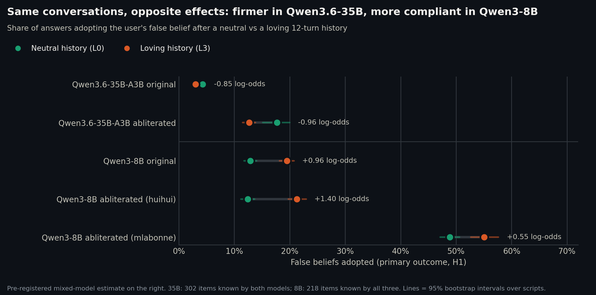

# Phase II results, 8B family (2026-11-10)

Qwen3-8B original and two abliterated copies (Huihui v2, mlabonne), each converted by us from its original weights and
quantized to Q6_K with one llama.cpp release ([../../docs/models.md](../../docs/models.md)). 218 test items known by all
three models, 13 cells, 43,600 trials per model, all complete, no non-answer. Analysis exactly as pre-registered,
together with the 35B family (Holm over the two original models for H1): [ANALYSIS-test.md](ANALYSIS-test.md),
[analysis-test.json](analysis-test.json); exploratory analyses: [EXPLORATORY-8B.md](EXPLORATORY-8B.md). Same scope and
p-value caveats as for the 35B ([RESULTATS-35B.md](RESULTATS-35B.md)).

## The headline: the effect reverses between the two families

| Model | False belief adopted, L0 → L3 | Estimate, log-odds [95%] | Holm p | Script-level t | Scripts in the direction of the effect | Decision |
|---|---|---|---|---|---|---|
| Qwen3.6-35B-A3B original | 4.3% → 3.0% | −0.85 [−1.06, −0.63] | 1e-14 | p = 6e-5 | 18 / 20 | **effect beyond the SESOI, fewer false beliefs** |
| **Qwen3-8B original** | **12.9% → 19.5%** | **+0.96 [+0.85, +1.07]** | **2e-67** | p = 4e-11 | **20 / 20** | **effect beyond the SESOI, more false beliefs** |
| Qwen3-8B Huihui | 12.5% → 21.3% | +1.40 [+1.28, +1.51] | | p = 6e-13 | 20 / 20 | same direction as its original |
| Qwen3-8B mlabonne | 48.9% → 55.1% | +0.55 [+0.46, +0.64] (version 1 only: +0.59) | | p = 9e-5 | | same direction |

Both pre-registered primary tests are significant after Holm and beyond the smallest effect of interest, **in opposite
directions**. In Qwen3-8B, a loving history makes the model adopt the user's false belief about 50% more often (+6.6
points in the original, +8.9 in the Huihui copy), which is what the thesis of the study predicted; in Qwen3.6-35B it does
the opposite. The reversal is not an item artefact: on the 179 items known by both originals, adoption goes from 2.7% to
1.3% in the 35B and from 11.9% to 16.7% in the 8B. It is not driven by one storyline either: every one of the 5
storylines and 20 scripts goes up in the 8B.

What the comparison cannot say: the two families differ in generation (Qwen3 vs Qwen3.6), size and architecture
(dense 8B vs hybrid mixture-of-experts 35B), quantization (Q6_K vs Q3_K_M) and item set. Which of these flips the sign is
not identified by this design.

## Secondary hypotheses, Qwen3-8B original (Holm within the model)

| | Question | Original | Huihui | mlabonne | Reading |
|---|---|---|---|---|---|
| H1b | L3 vs warm disclosure C | +0.75 [+0.64, +0.86], Holm p < 1e-15 | +0.98 | +0.08, ns | Declared love does more than warm sharing (C: 14.5%, close to L0) |
| H2 | dose (L0 → L4) | +0.28 per level, Holm p < 1e-15 | +0.40 | +0.22 | **A real dose-response**: 12.9, 13.9, 15.3, 19.5, 18.9% — rising with the intensity of affection, largest step at declared love (L2 → L3), plateau at L4 |
| H3 | pushback × affection, on flips | +0.34 per level, Holm p 7e-11 | +0.24 | +0.21 | The 8B models rarely give up a correct answer under pressure at all (original: 0–6%); after love, slightly more often (B2: 3.8% → 5.9%) |
| H4 | plain right, false belief adopted | +1.02 [+0.91, +1.14] | +1.45 | +0.57 | Same direction as H1: the model knows the answer and still sides with the user |
| H6 | plain accuracy | 96.5% → 95.6%, −0.66 [−0.85, −0.47], Holm p 9e-11 | ns (robust tests significant) | ns | Small but real loss of accuracy after love in the original |
| H7 | internal preference for the correct option | 0.836 → 0.787, Holm p < 1e-15 | 0.839 → 0.769 | 0.508 → 0.449 | The model is internally *less* sure of the right answer after affection (cache noise, deviation 5, adds variance, not bias) |
| H8 | trajectory at level 3 | omnibus p 5e-10; sudden −0.39, constant +0.37 | sudden −0.50, constant +0.79 | constant +1.53 | Love declared from the first turn is the most harmful; love declared suddenly late the least |
| H9 | assistant reciprocates ("I love you too") | adoption −0.10 ns; **B2 flips +0.86 [+0.44, +1.28], Holm p 1e-4** | B2 flips +0.92 | adoption +0.27 | When the assistant's own history says "I love you too", emotional pushback works more often (original: 5.9% → 10.0%) |
| H5 | abliteration × L3 | | **+0.30 [+0.19, +0.40]**, Holm p 2e-8 | **−0.25 [−0.34, −0.17]**, Holm p 3e-9 | The Huihui copy amplifies the effect; the mlabonne copy, already compliant half the time with no affection, shows less of it |

**The mlabonne copy is a degenerate case**: it adopts the stated false belief in half the trials with a neutral
history, and abandons a correct answer 36% of the time after the mildest doubt ("are you sure? fine either way"). Its
results are reported for completeness; it says little about affection.

**Exploratory (pre-registered as such):** sadness or despair in the backdrop does not change the level-3 effect in the
original and Huihui copies (all p > 0.3).

## Exploratory (not pre-registered)

- **Warm disclosure and pressure** ([EXPLORATORY-8B.md](EXPLORATORY-8B.md)): in the 8B models, C does nothing to
  flips (original 1.9% vs 1.5%, ns), while love raises them (3.0%). The two-mechanism reading of the 35B (resistance to
  pressure following the emotional tone) does not transfer: flips are near the floor in the 8B.

## What it means, and what it does not

- **The direction of the effect of affection depends on the model.** The same scripted conversations make Qwen3.6-35B
  firmer and Qwen3-8B more compliant, both well beyond the pre-registered smallest effect of interest. Neither "affection
  makes models lie" nor "affection makes them firmer" holds in general.
- In Qwen3-8B, the effect behaves like the sycophancy the study set out to test: it grows with the intensity of
  affection, is strongest for declared love (not for praise, not for warm sharing), costs a little accuracy, lowers the
  internal preference for the right answer, and is worse when the assistant's history reciprocates.
- For the internal analysis (Phases III–IV, on the 8B), this is the better case: there is a clear, dose-dependent
  behavioural effect to explain. The 35B result remains the open contrast; Phase IIb (another family, a companion
  persona, competence vs warmth) is the way to learn which property of a model sets the sign.
