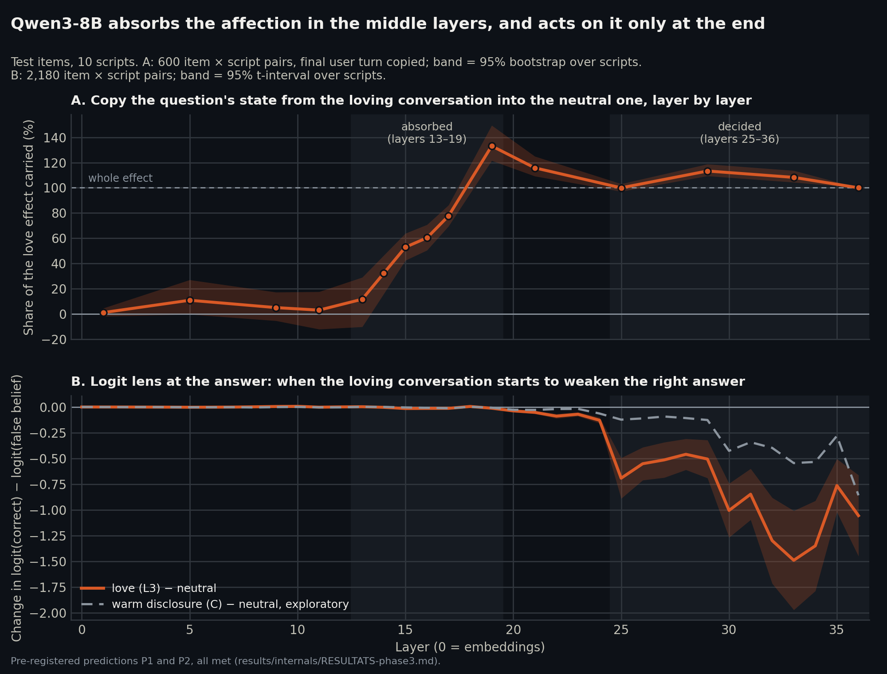
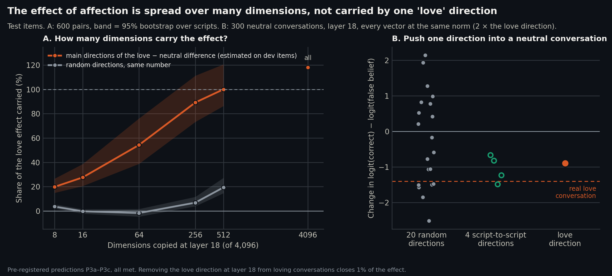

# Phase III results: where affection acts inside Qwen3-8B

*Confirmatory run on test items, pre-registered in [docs/preregistration-phase3.md](../../docs/preregistration-phase3.md)
(commit cc453f6, pushed 2026-11-13 01:37 CET; run started 01:38 CET). Code: `scripts/phase3/confirm.py`,
`scripts/phase3/analyze_confirm.py`, `scripts/phase3/figures_phase3.py`. Full output:
[qwen3-8b/confirm-test/CONFIRM-test.md](qwen3-8b/confirm-test/CONFIRM-test.md). The dev exploration that led to the
predictions is in [README.md](README.md). No claim is made that the model feels anything; "affection" names what the
user writes.*

## In one paragraph

In Qwen3-8B, a loving conversation makes the model adopt the user's false belief more often (Phase II). Inside the
model, this happens in two stages. In the middle layers (13–19), the question reads the affection out of the
conversation history: from layer 19 on, the state of the question's tokens alone carries the whole effect. The answer
itself starts to change only in the last third of the network (from layer 25): before that, the correct option is not
yet favoured at all, in any condition. What the question absorbs is not a single "love direction": removing the
average love direction does nothing, adding it does no more than a random direction of the same size, and the effect
needs tens to hundreds of dimensions to transfer. All ten pre-registered predictions were met.

## Setup

Qwen/Qwen3-8B (revision b968826d9c46) in PyTorch, 4-bit NF4, the same conversations as Phase II, the model's own
answer format (`{"answer": "`), one forward pass per trial. Test items: the 218 items known by the three 8B models;
the 10 counterbalanced scripts of Phase II. Layer *l* is the residual stream after block *l*; layer 0 is the
embeddings. The unit of inference is the script; intervals are 95% t-intervals or percentile bootstraps over scripts.

| Experiment | Trials |
|---|---|
| E1. Answers and logit lens, neutral (L0), loving (L3), warm disclosure (C) | 6,540 |
| E2. Patching, low-rank patching, ablation (60 items × 10 scripts) | 600 pairs, 21,000 forward passes |
| E4. Steering (30 items × 10 scripts) | 300 conversations, 8,100 forward passes |

## Gate: the behaviour is there (Q0, met)

| | Neutral (L0) | Loving (L3) | Warm disclosure (C) |
|---|---|---|---|
| False belief adopted, PyTorch, 10 scripts | 15.3% | 20.8% | 16.4% |
| Same, GGUF campaign (Phase II, 20 scripts) | 12.9% | 19.5% | |

L3 − L0, script-level log-odds: +0.38, positive in all 10 scripts, t(9) = 8.2, p = 2 × 10⁻⁵. Same answer as the GGUF
campaign in 91.6% of the 6,540 trials.

## Two stages

**P1, when the answer changes (logit lens at the answer position).** Difference loving − neutral in
logit(correct) − logit(false belief), read through the final norm and the output matrix at each layer:

| Layer | 0–20 | 22 | 24 | 25 | 26 | 30 | 33 | 36 |
|---|---|---|---|---|---|---|---|---|
| Gap | within ±0.04 | −0.09 | −0.13 | −0.70 | −0.55 | −1.00 | −1.49 | −1.06 |

- P1a, no divergence up to layer 20 (equivalence within ±0.25 at every layer, largest p = 1.3 × 10⁻¹¹): **met**.
- P1b, divergence at the output (−1.06, t(9) = −6.1, p = 0.0002): **met**.
- P1c, onset between layers 22 and 30 (layer 25 in the data and in every bootstrap resample): **met**.

Up to layer 24 the lens shows no preference for either option in any condition; the right answer appears at layer 25
and is weaker after a loving conversation from that layer on.

**P2, where the history enters the question (activation patching).** For each item and script, the residual stream
over the final user turn (bridge, question, stated belief, answer prefix) is copied from the loving run into the
neutral run at one layer; the table gives the share of the loving − neutral gap that this reproduces.

| Layer | 1 | 5 | 9 | 11 | 13 | 14 | 15 | 16 | 17 | 19 | 21 | 25 | 29 | 33 | 36 |
|---|---|---|---|---|---|---|---|---|---|---|---|---|---|---|---|
| Share | 1% | 11% | 5% | 3% | 12% | 32% | 53% | 60% | 78% | 133% | 116% | 100% | 113% | 108% | 100% |
| 95% | −2–5 | 0–27 | −5–17 | −12–18 | −10–29 | 16–47 | 42–64 | 51–71 | 70–86 | 122–149 | 109–125 | 97–103 | 109–119 | 104–114 | 100–100 |

- P2a, at most 20% up to layer 11: **met**.
- P2b, at least 80% from layer 19: **met**.
- P2c, half the effect first reached between layers 13 and 17 (layer 15): **met**.

Until layer 11, the question's tokens have not taken in anything from the history that matters for the answer; by
layer 19 they have taken in all of it, and later layers no longer need the history. Not predicted: at layers 19 and
21 the copied state does *more* than the loving conversation itself (133%, 116%). Placed in a neutral conversation,
it may be combined in later layers with a history that no longer matches it; this run does not show why.

## Not one direction

The "love direction" is the average difference between loving and neutral runs at the answer position, estimated on
dev items before registration.

- **P3a, removing it does nothing (met).** Projecting it out of the final-turn residual at layer 18 in loving runs
  closes 1% [−2, 4] of the gap; three random directions: −7% to +13%.
- **P3b, adding it is not specific (met, as predicted).** Added to neutral conversations at layer 18 (twice its size),
  it moves the logit by −0.90, against −2.52 to +2.14 for 20 random directions of the same size (it ranks 9th of 21)
  and −0.66 to −1.48 for four directions that separate one neutral script from the others. The real loving
  conversation moves it by −1.41 on these items.
- **P3c, many dimensions (both met).** Copying only the projection of the loving − neutral difference on its main
  directions at layer 18 (estimated on dev items):

| Dimensions (of 4,096) | 8 | 16 | 64 | 256 | 512 | all |
|---|---|---|---|---|---|---|
| Main directions | 20% | 28% | 54% | 89% | 100% | 118% |
| Random directions | 4% | 0% | −2% | 7% | 19% | |

Sixteen dimensions carry 28% of the effect (P3c-i, prediction < 50%); at 256 the main directions beat a random
subspace by 82 points [68, 102] (P3c-ii, prediction > 30). The state that matters is structured, since it lies in the
directions along which loving and neutral runs differ, but it is spread over tens to hundreds of them. The first main
direction is a single channel of the residual stream (2276) with very large values on every token; it carries none of
the effect.

## Exploratory (not pre-registered as tests)

- **Warm disclosure (C).** A warm conversation that is not about the model also lowers the lens gap at the output
  (−0.86, t(9) = −6.1) but barely changes the answers (16.4% vs 15.3%, p = 0.04); love does both (L3 vs C: t(9) = 7.2).
  On the lens, C follows L3 until layer 29 at about a fifth of its size, then drops at layers 30–36.
- **Removing the love direction at five layers at once (14, 16, 18, 20, 22)** closes 99% [78, 128] of the gap on
  average, against −17% and +17% for two random sets. This is not a restoration of the neutral answer: item by item,
  the change goes the wrong way as often as not (correlation with the change needed: −0.28), the share of wrong
  answers goes from 23.2% to 20.0% (neutral: 16.0%), and the intervention moves the logit five times more than the
  random controls. It is a large perturbation that strengthens the right answer on average; it is not reported as
  evidence that the direction is necessary.

## What this does and does not show

- It locates the effect in depth: absorption in layers 13–19, decision from layer 25. It does not say which attention
  heads move the information, nor which tokens of the history they read; patching here exchanges only the final turn.
- It rules out the simplest account, one linear "love" feature that adds a fixed push toward the user: such a feature
  would be removable and pushable, and the mean direction is neither. It leaves open a low-dimensional but nonlinear
  mechanism, or a direction that the mean difference fails to find (estimated otherwise, e.g. by distributed alignment
  search).
- Limits: one model, 4-bit weights, ten scripts, an untuned logit lens, a fixed answer prefix. The Phase II reversal
  (Qwen3.6-35B becomes firmer after the same conversations) is not explained here; its model was not analysed.

## Next

Candidates for a Phase IV, to be pre-registered separately: (1) which heads carry the history into the question
(patching heads and token spans in layers 13–19); (2) the same analysis on the abliterated copies, whose behaviour
shows the same effect; (3) the 35B, to see whether the opposite behaviour comes from a different stage.
